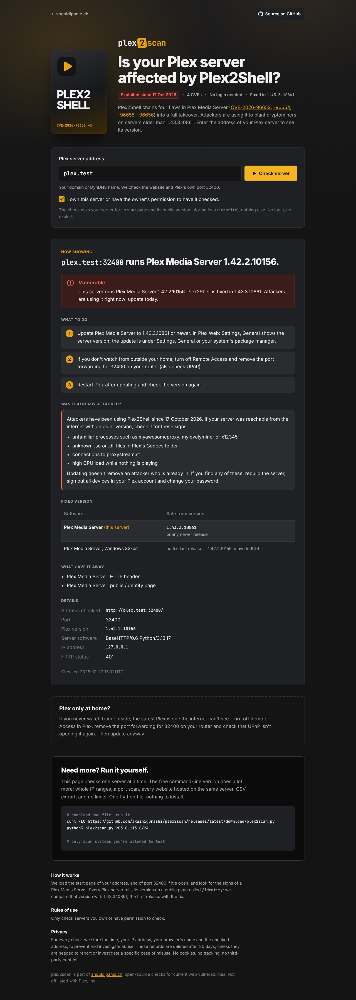

<h1>
  <picture>
    <source media="(prefers-color-scheme: dark)" srcset="docs/logo-dark.png">
    
  </picture>
</h1>

Finds Plex Media Servers affected by **Plex2Shell**, the chain of four flaws
(CVE-2026-96652, CVE-2026-96654, CVE-2026-96655, CVE-2026-96656) that lets
attackers take over a Plex Media Server older than **1.43.3.10861** without
logging in. Part of [shouldipanic.ch](https://shouldipanic.ch).

Plex2Shell has been exploited since 17 October 2026 (cryptominers, proxies) and
is on CISA's Known Exploited Vulnerabilities list. Every Plex Media Server older
than 1.43.3.10861 that can be reached from the internet is at risk.

plex2scan comes in two forms:

- **`plex2scan.py`**: a single Python file with no dependencies for checking
  your own servers: IP ranges, port scan including Plex's port 32400, vhost
  discovery and the Plex version check.
- **A web page** (Docker image) where anyone can check one server, with abuse
  protection. It runs at [plex2scan.shouldipanic.ch](https://plex2scan.shouldipanic.ch).



## How it finds the version

Every Plex Media Server answers `GET /identity` without a login and tells its
version there. plex2scan loads the start page (to recognise Plex by its
`X-Plex-Protocol` header or the Plex Web page) and asks `/identity` once.
Nothing else is sent: no login, no exploit.

## Command line

```bash
curl -LO https://github.com/akaihigurashi/plex2scan/releases/latest/download/plex2scan.py
python3 plex2scan.py 203.0.113.0/24
```

Python 3.8 or newer, nothing to install. Examples:

```bash
python3 plex2scan.py 203.0.113.10                     # 21 ports incl. 32400 + every vhost on the IP
python3 plex2scan.py 203.0.113.10:32400               # only Plex's own port
python3 plex2scan.py plex.example.ch                  # a Plex behind a reverse proxy
python3 plex2scan.py 203.0.113.0/24 --names domains.txt    # + hostnames from your own data
python3 plex2scan.py 203.0.113.10 -p all -o out.csv   # all 65535 ports, CSV output
python3 plex2scan.py -h                               # all options
```

| Status | Meaning |
|---|---|
| `VULNERABLE` | Plex Media Server older than 1.43.3.10861 |
| `POSSIBLY VULNERABLE` | Plex Media Server found, version hidden |
| `PATCHED` | Plex Media Server 1.43.3.10861 or newer |
| `NOT DETECTED` | No Plex Media Server visible |

Results are listed worst first, with a short reason. Hidden results (closed ports,
errors, vhosts that only show the default site) appear with `-a`, the evidence with `-v`.

| Option | What it does |
|---|---|
| `-p LIST` | Ports: `web` (20 common ports + 32400, default), `all`, or `80,443,32400` |
| `-n` | No port scan, only 443 and 80 |
| `--names FILE` | Your own hostname list, checked as vhosts |
| `--no-vhosts` | Don't look for other websites on the same IP |
| `-a` / `-v` | Show hidden results / show the evidence |
| `-o FILE` | Also write all results to CSV |
| `-d` | Debug: every request, header and match |
| `-q` | No banner (for scripts) |
| `-V` | Print the version |
| `-h` | All options |

## If a server is vulnerable

1. Update Plex Media Server to 1.43.3.10861 or newer. Windows 32-bit gets no fix
   (last release 1.42.2.10156): move to 64-bit.
2. If nobody watches from outside, turn off Remote Access and remove the port
   forwarding for 32400 (check UPnP too).
3. Check for signs of an attack: unfamiliar processes such as `myawesomeproxy`,
   `mylovelyminer` or `x12345`, unknown `.so`/`.dll` files in Plex's Codecs folder,
   connections to `proxystream.st`, high CPU load while nothing plays. Updating
   doesn't remove an attacker who is already in.

### API keys for more passive DNS sources

AlienVault OTX and HackerTarget work without keys. VirusTotal, Shodan and
SecurityTrails need an API key, read from environment variables:

| Variable | Source |
|---|---|
| `PANIC_VT_KEY` | VirusTotal passive DNS |
| `PANIC_SHODAN_KEY` | Shodan hostnames |
| `PANIC_SECURITYTRAILS_KEY` | SecurityTrails reverse IP |

Keep them in a `.env` file only you can read, and load it just for the scan:

```bash
( set -a; . ./.env; set +a; python3 plex2scan.py 203.0.113.10 )
```

`--vt-key`, `--shodan-key` and `--securitytrails-key` also work, but command-line
arguments are visible to other local users (`ps`) and end up in your shell history.
Key values are masked in error messages. (Thanks to Jonas Hüsser for this.)

## Web page with Docker

```bash
docker run -d --name plex2scan --restart unless-stopped \
  -p 127.0.0.1:8091:8091 \
  -e PANIC_ORIGIN=https://plex2scan.example.ch \
  -v plex2scan-data:/data \
  ghcr.io/akaihigurashi/plex2scan:latest
```

Or with Compose: download [`docker-compose.yml`](docker-compose.yml), set
`PANIC_ORIGIN`, then `docker compose up -d`. The container listens on localhost
only; put a reverse proxy with TLS in front of it
([nginx example](deploy/nginx.conf)).

| Variable | Default | Purpose |
|---|---|---|
| `PANIC_ORIGIN` | – | Public address. Requests from other origins are refused. **Set it.** |
| `PANIC_OPERATOR` / `PANIC_CONTACT` | – | Optional contact section at the bottom of the page |
| `PANIC_IMPRINT_URL` | – | Optional link to an existing imprint |
| `PANIC_TRUSTED_PROXY` | `127.0.0.1,::1` | Proxies whose `X-Real-IP` header is trusted |
| `PANIC_DENY_HOSTS` / `PANIC_DENY_IPS` | – | Never check these domains / addresses |
| `PANIC_AUDIT_DIR` | `/data/audit` | Daily audit log files |
| `PANIC_RETENTION_DAYS` | `30` | Audit files older than this are deleted |

The page has the same protections as [php2scan](https://github.com/akaihigurashi/php2scan#abuse-protection):
consent checkbox, audit log, VPN/Tor/datacenter clients refused, rate limit,
result cache, public hostnames only with the connection pinned to the checked
address, websites that are never checked (well-known services, the 100 most
visited sites, government sites, sanctioned countries), and no access from
sanctioned countries. Besides the website itself (443, then 80) the page only
looks at port 32400, and only if it is open.

## How it's built

The scanner engine (fetching, fingerprinting, port scan, vhost discovery, web
server) lives in [panic-core](https://github.com/akaihigurashi/panic-core).
Everything specific to Plex2Shell is in [`check.py`](check.py).
`plex2scan.py` and `web.py` are generated from both:

```bash
git clone https://github.com/akaihigurashi/panic-core ../panic-core
python3 ../panic-core/bundle.py check.py
```

## License

GPL-3.0, see [LICENSE](LICENSE). Fonts: Inter and JetBrains Mono (SIL Open Font
License). Not affiliated with or endorsed by Plex, Inc.; "Plex" is their trademark.
